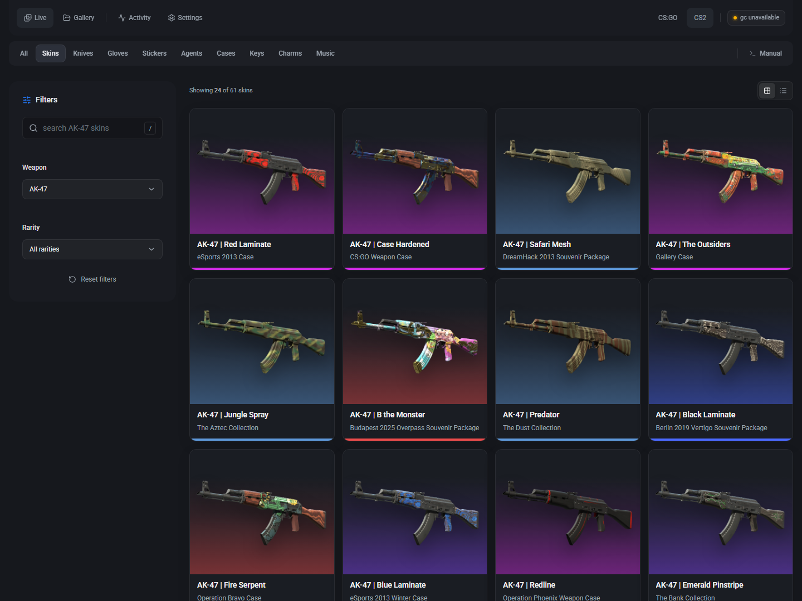
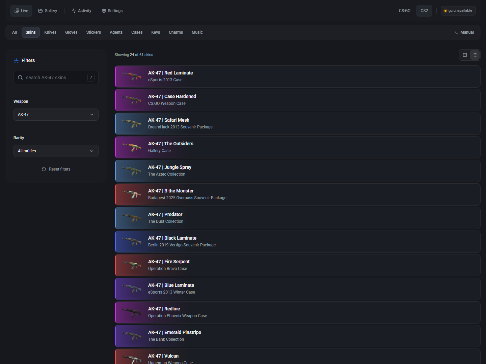
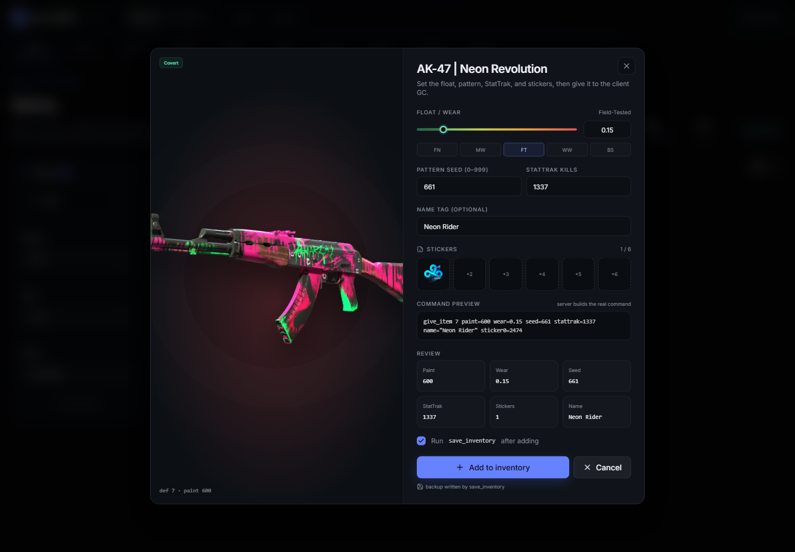
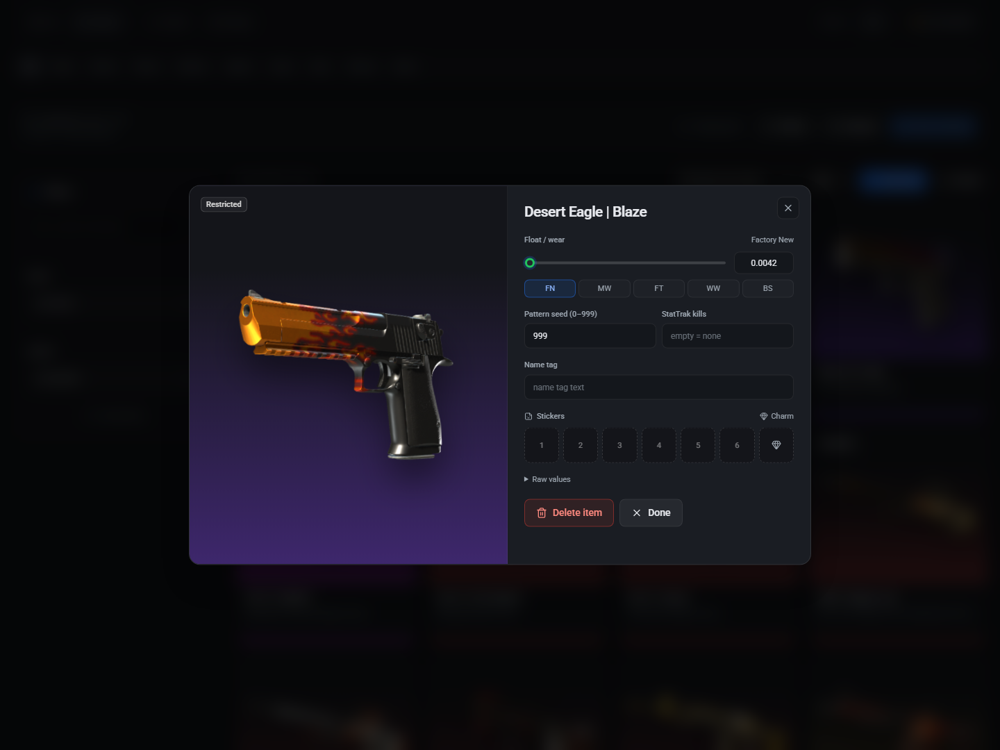
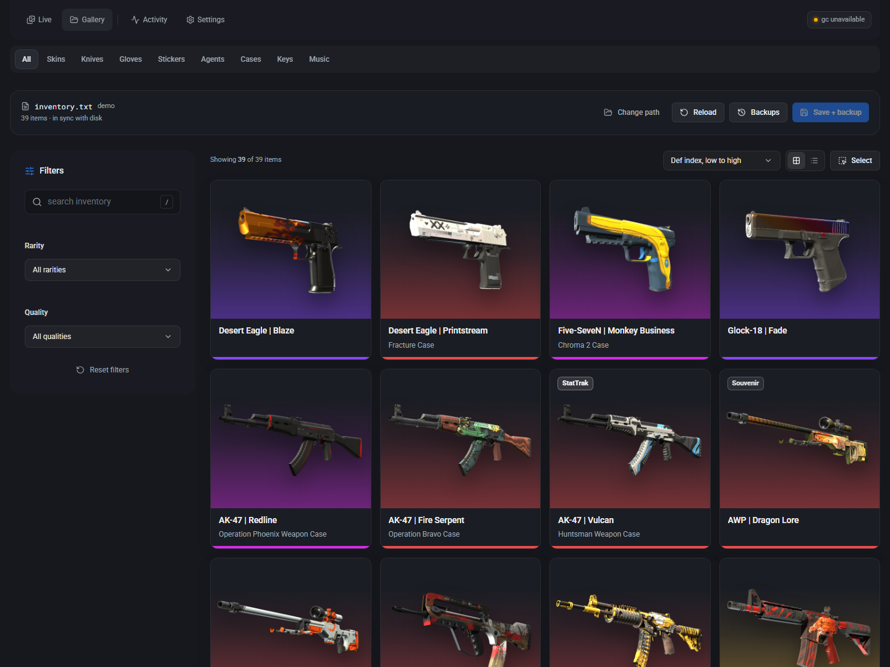
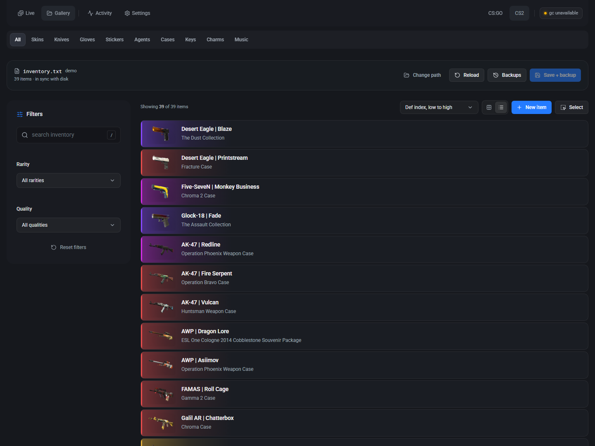
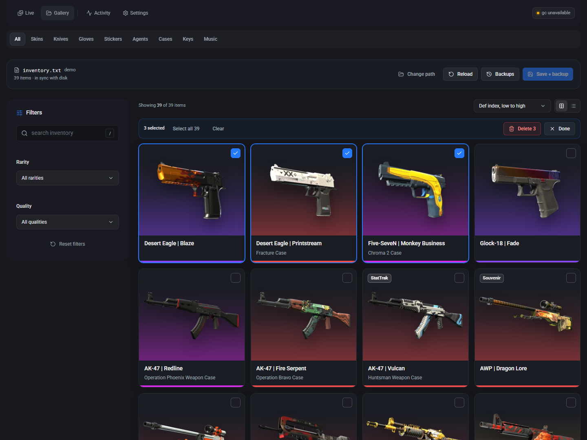

# gc-editor
An inventory web editor for [GT-610's csgo_gc](https://github.com/GT-610/csgo-gc), for **CS:GO and CS2**, with support for live gives and editing `inventory.txt` without the game running.





## Requirements
- Node.js version 20+
- For live editing, [GT-610's csgo_gc fork](https://github.com/GT-610/csgo-gc)
- RCON enabled within `csgo_gc/config.txt` (CS:GO) or `game/csgo_gc/config.txt` (CS2) in your game installation

## Games
CS:GO and CS2 can be installed side by side. gc-editor detects both Steam folders automatically (`csgo legacy` and `Counter-Strike Global Offensive`). The CS:GO / CS2 switch lives in the Gallery: each game keeps its own schema, case index, image cache, and `inventory.txt` path, so nothing is overwritten when you swap. Live RCON always uses CS:GO, because that is the only game the GC supports, and the switch is hidden there. Settings accepts manual directory overrides per game (`CSGO_LEGACY_DIR` and `CS2_DIR` environment variables work too).

CS2 stores its game files under `<install>/game`, so the default CS2 paths resolve to `game/csgo_gc/inventory.txt` and `game/csgo/...`.

## Usage
Install the latest release from the Releases tab in GitHub, or `git clone` this repository.

To run in production mode:
```bash
npm ci
npm run build
npm run build-cases # optional, grabs case and collection names for skins
npm start
```

This serves the web app on port 5174. Simply navigate to `localhost:5174` in your web browser. To configure live editing, make sure that the IP address, port, and password in the Settings tab match the RCON configuration within csgo_gc's config.

With one-time setup, gc-editor can also run fully offline. Local image caching is also supported and requires approximately 5 GB of free space for CS:GO imagery (CS2 is cached separately).

```bash
npm run fetch-schema     # JSON schema for both catalogues (CS:GO is filtered, CS2 is upstream)
npm run build-cases      # case + collection names per game
npm run prefetch-images  # optional, fetches artwork into imgs/ (CS:GO) and imgs/cs2/
```

Add `-- --game=cs2` (or `--game=csgo`) to `fetch-schema`, `build-cases`, or `prefetch-images` to process one game. CS:GO case data comes from the installed `items_game.txt`; CS2 case data comes from the upstream crate/collection endpoints because CS2 packs those scripts into VPKs.

For offline editing of `inventory.txt`, **close the game before saving changes** so it cannot overwrite your edits with its in-memory inventory.

## Custom CSS

gc-editor allows for custom CSS support. There is support for both editing `~/.gc-editor/custom.css` directly in your favourite text editor/IDE, or through the Settings menu within the app.

If a theme breaks the layout, open the app with `?safe=1` and clear the sheet in Settings. You can also restore a previous backup (`.bak` which will be located in the same directory as the CSS file itself).

## Screenshots










## AI usage disclaimer
This project was fully vibecoded in an afternoon using a mixture of Kimi K3.1 Pro (frontend) and Deepseek V4.1 Flash (backend). This code hasn't been rigorously tested and was meant for personal use, but I have decided to publish it anyway. I may decide to maintain code in the near future, but it's not a guarantee. Feel free to fork and fix any mistakes I've inevitably made.
